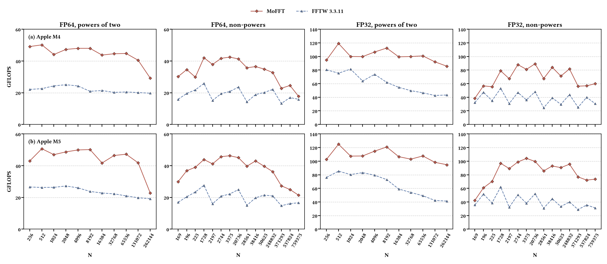

# MoFFT

[](https://github.com/ruge-zhang/MoFFT/actions/workflows/ci.yml)
[](LICENSE)
[](https://ruge-zhang.github.io/MoFFT/)

MoFFT is a matrix-oriented FFT library and kernel compiler for Arm SME/SME2.
It supports FP32/FP64 one-dimensional complex transforms, forward and backward,
in-place and out-of-place.

## Download

[MoFFT 0.4.0 Preview 1](https://ruge-zhang.github.io/MoFFT/#downloads) targets
Apple M5/macOS. Choose the library source package with pre-generated kernels,
or the optional prebuilt SDK. Building the prepared source package does not
require Python or kernel generation.

- [Downloads and release notes](https://github.com/ruge-zhang/MoFFT/releases/tag/v0.4.0-preview.1)
- [Install, link, and use the C API](docs/INSTALLATION.md)
- [Planning policies and saved plans](docs/BINARY_DISTRIBUTION.md)
- [Development, tuning, and experiment reproduction](docs/REPRODUCING.md)

The API follows a plan/execute/destroy lifecycle. Select `MOFFT_FLAG_PRETUNED`
to use packaged choices or `MOFFT_FLAG_MEASURE` to search linked candidates.
This is a functional preview, not an FFTW ABI replacement or a new formal
performance result.

## Performance



See the [evaluation guide](docs/REPRODUCING.md) for the published figure's
reproduction workflow, separate from preview-package validation.

## Citation

If you use MoFFT in your research, please cite our papers:

The MoFFT citation below uses the final journal volume, issue, and page numbers
from [IEEE Xplore](https://ieeexplore.ieee.org/document/11706712).

```bibtex
@article{zhang2026mofft,
  author  = {Ruge Zhang and Haipeng Jia and Xiang Zhao and Yunquan Zhang and Zhihao Li and Yibo Wang},
  title   = {{MoFFT}: Matrix-Oriented {FFT} Optimization Leveraging Outer-Product Operations on {ARM SME CPUs}},
  journal = {IEEE Transactions on Parallel and Distributed Systems},
  year    = {2026},
  volume  = {37},
  number  = {12},
  pages   = {2659--2675},
  month   = dec,
  doi     = {10.1109/TPDS.2026.3737077},
  url     = {https://ieeexplore.ieee.org/document/11706712}
}

@inproceedings{zhang2024openfftsme,
  author    = {Ruge Zhang and Haipeng Jia and Yunquan Zhang and Baicheng Yan and Penghao Ma and Long Wang and Wenxuan Zhao},
  title     = {{OpenFFT-SME}: An Efficient Outer Product Pattern {FFT} Library on {ARM SME CPUs}},
  booktitle = {2024 IEEE International Parallel and Distributed Processing Symposium (IPDPS)},
  year      = {2024},
  pages     = {938--949},
  publisher = {IEEE},
  doi       = {10.1109/IPDPS57955.2024.00088},
  url       = {https://ieeexplore.ieee.org/document/10579263}
}
```

## Community and license

[Issues](https://github.com/ruge-zhang/MoFFT/issues) ·
[Contributing](CONTRIBUTING.md) · [Security](SECURITY.md).
Licensed under [Apache-2.0](LICENSE).
